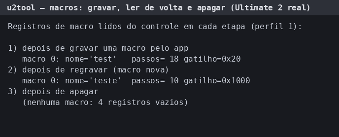
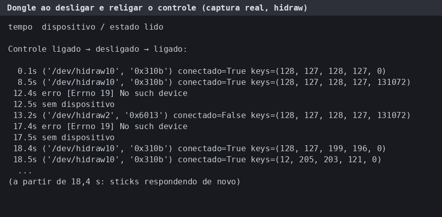

# u2tool — configurador do 8BitDo Ultimate 2 para Linux

Configurador **não oficial** para o 8BitDo Ultimate 2 (dongle 2.4G ou cabo) no Linux:
perfis, mapeamento, sticks, gatilhos, vibração, RGB, giroscópio, leitura ao vivo e macros.
Fala direto com o `/dev/hidraw`, sem driver. Em Rust (egui), com o protocolo documentado em
[PROTOCOLO.md](PROTOCOLO.md).

> **Aviso.** Projeto independente, sem relação com a 8BitDo. "8BitDo" e "Ultimate" são marcas
> dela. Isto **grava configuração no seu controle**: faça backup antes (`python3 u2tool.py dump
> backup.bin`). Atualização de firmware **não** é suportada (pode inutilizar o controle).
> Testado em **um** controle (Ultimate 2 pelo dongle 2.4G, CachyOS): se testar em outro, conte.

## Como foi feito

O protocolo foi obtido por engenharia reversa do app oficial para Windows, para
interoperabilidade, e conferido no controle real. **Este repositório não contém nenhum arquivo
da 8BitDo**: nem o app, nem DLLs, nem imagens ou textos. A interface reproduz a disposição do
app oficial e usa as imagens e os textos dele, que o próprio script extrai do zip que **você**
baixa do site da 8BitDo e que ficam só na sua máquina. Se isso é adequado ao seu caso, a
decisão é sua.

## Instalar

Gera um AppImage a partir do zip oficial (Ultimate Software V2 para Windows), baixando o que
faltar numa pasta temporária que é apagada no fim:

```bash
python3 build_appimage.py ~/Downloads/8BitDo_Ultimate_Software_V2_Windows_*.zip
./dist/8BitDo_Ultimate_Software_V2-x86_64.AppImage
```

Precisa só de python3 e de um compilador C; reaproveita cargo, dotnet, ilspycmd e appimagetool se
já existirem. `--so-verificar` mostra o plano sem baixar nada; `--assets DIR` usa imagens já
extraídas; `--saida DIR` muda o destino. O AppImage leva material da 8BitDo: **uso pessoal,
não redistribua**.

Alternativa sem AppImage: `python3 extract_assets.py ZIP` e depois `./install.sh`
(instala no usuário e cria o atalho no menu; `./install.sh --remover` desfaz).

## Usar

```bash
u2tool                      # interface; grava no controle
u2tool --somente-leitura    # não grava nada
u2tool --offline x.bin      # edita um backup, sem controle
python3 u2tool.py info      # estado do controle
python3 u2tool.py dump x.bin   # lê tudo, salva backup, mostra decodificado
```

No cabo/dongle o acesso ao hidraw costuma funcionar sozinho (`uaccess` do systemd). Sem ele,
é preciso uma regra udev para o VID `2dc8`.

## Validação

Leituras reais do controle (sem arte nem material da 8BitDo). Detalhes em
[docs/validacao.md](docs/validacao.md).

| Macros: gravar, ler de volta, apagar | Dongle ao desligar/religar o controle |
| --- | --- |
|  |  |
